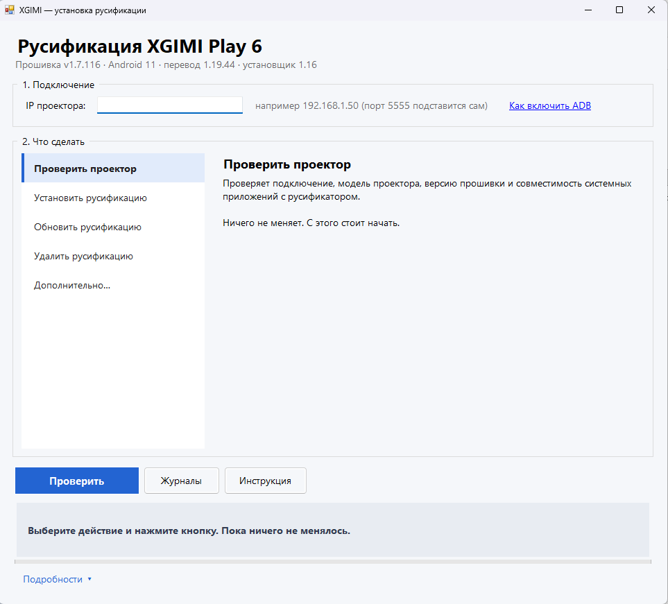
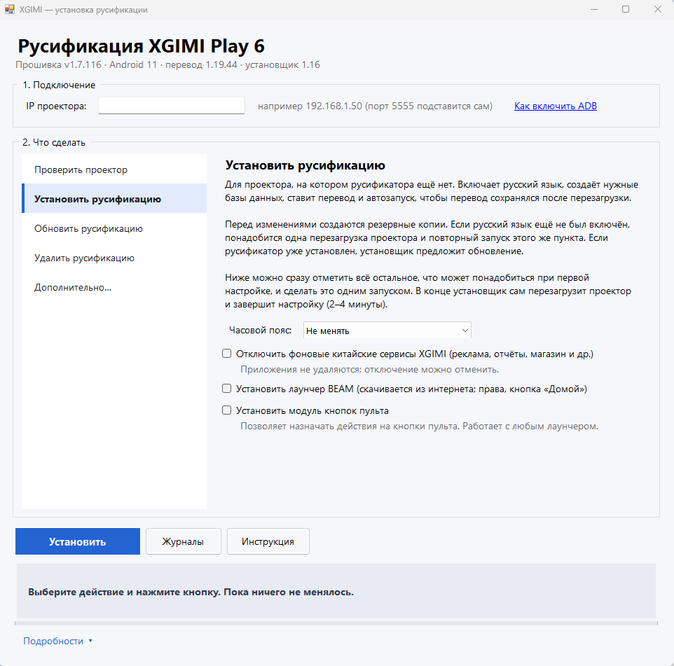
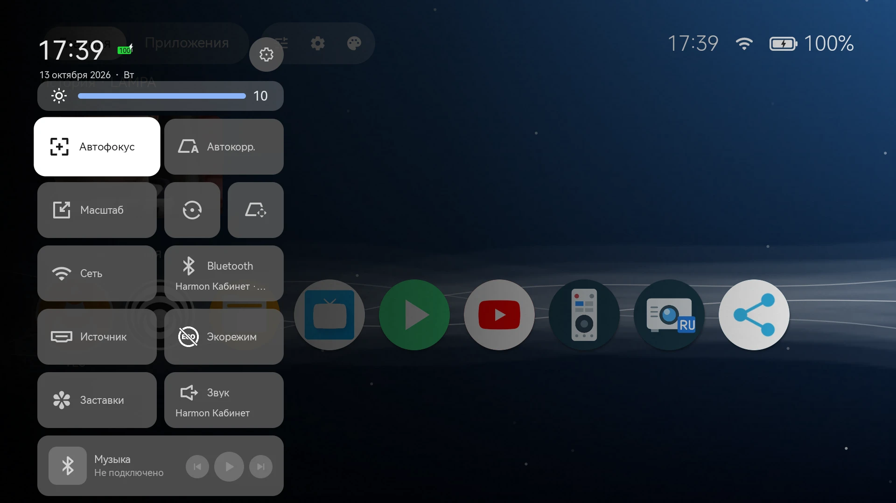
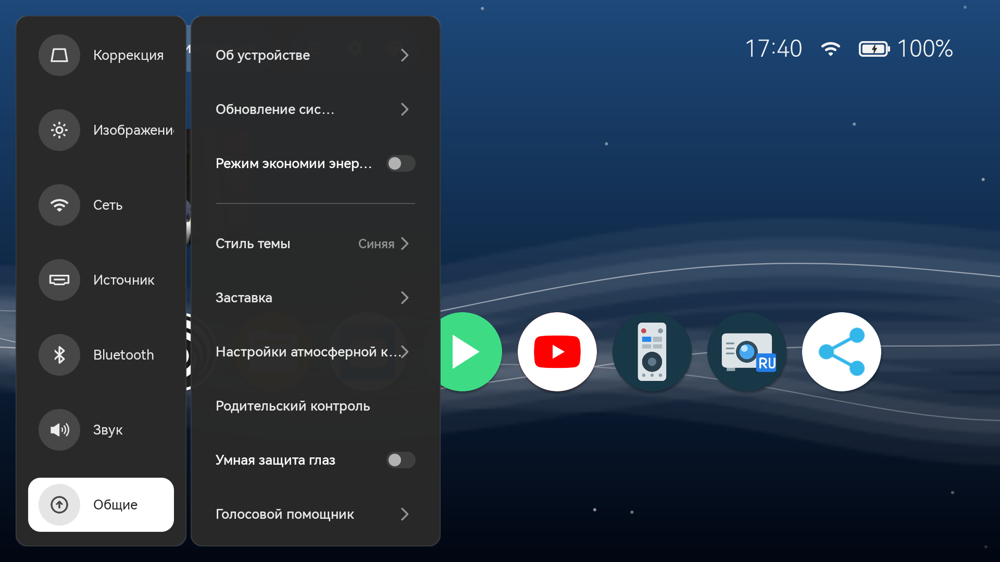
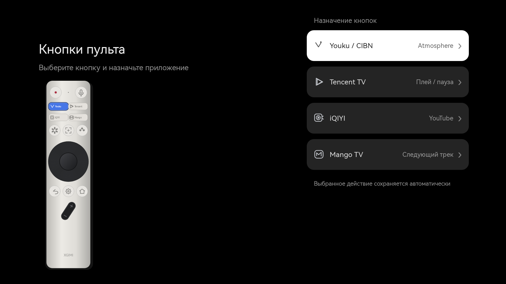

# XGIMI Russifier

Русификация штатного интерфейса **XGIMI Play 6**: настройки, быстрая панель, системные уведомления, Atmosphere и системные приложения. Проект также добавляет в быструю панель управление яркостью, сведения о Bluetooth и кнопку «Звук».

Это отдельный проект, **не часть BEAM Launcher**. Перевод применяется к приложениям XGIMI; исходники и APK лаунчера не изменяются.

Исходники и payload — версия **1.19.44** (подробно в [STATUS.md](STATUS.md)); собранный Windows-комплект — **1.19.44 / Setup1.16** (`dist/XGIMI-Russifier-1.19.44-Windows-Setup1.16`, отдельный ZIP и SHA256). Модуль кнопок **0.6-test** входит в комплект и устанавливается отдельным выбранным действием. Сохранены [исправления по четырём фото](investigation/photo-fixes-2026-10-12/RESULT.md), добавлена [первая группа переводов из сравнения с Titan](investigation/translation-batch1-2026-10-12/RESULT.md); добавлена [вторая группа уведомлений](investigation/translation-batch2-2026-10-12/RESULT.md). Проверка 1.19.17 подтверждена пользователем; 1.19.18 установлена; проверены файлы, службы и 55 ресурсных значений. Визуальная проверка новой группы ещё требуется. Автозапуск обеих служб после полного reboot проверен на Play 6 / v1.7.116 для 1.19.15. Полная установка после заводского сброса с другого ПК и физические испытания всех медиадействий ещё требуют проверки. Готовые комплекты находятся локально в `dist`; наличие нового кода не означает публикацию нового GitHub-релиза.

## Скриншоты

| Окно установщика | Установка с одной кнопки |
|---|---|
|  |  |

| Быстрая панель | Настройки проектора |
|---|---|
|  |  |

| Назначение кнопок пульта |
|---|
|  |

## Документация

- [Переносимый Windows-установщик EXE + папка](installer-ui/README.md).
- [Подготовка: русский язык, часовой пояс, китайские сервисы и BEAM](installer-ui/PREPARATION.md).
- [Начало установки](installer-ui/START-HERE.txt).
- [Установка, проверка, откат и устранение проблем](russifier/README.md).
- [Как устроен перевод](russifier/TRANSLATION.md).
- [Дополнение 1.19.8](russifier/DEVICE-UPDATE-1.19.8.md).
- [Независимые кнопки пульта: установка и отключение](russifier/REMOTE-BUTTONS.md).
- [Ревью 12 октября](russifier/REVIEW-2026-10-12.md).
- [Исправления и проверка после reboot](russifier/REVIEW-FIXES-2026-10-12.md).

## Совместимость

| Параметр | Проверенное значение |
|---|---|
| Модель | XGIMI Play 6 |
| Прошивка | v1.7.116 |
| Android / SDK | Android 11 / 30 |
| Product / device | `Product_dayao` / `dragon_healthy` |
| Компьютер для окна установщика | Windows 10/11 x64 (проверено на Windows 11); на Linux/macOS и других системах — [установка через ADB](russifier/MANUAL-OTHER-OS.md) |
| Соединение | Авторизованный ADB по локальной сети |

Установщик сверяет fingerprint, **18 исходных APK** и готовые файлы по SHA256. Совпадения названия модели недостаточно. Другая прошивка, неизвестная подмена APK или отсутствие диагностического доступа приводят к остановке. Старый скачанный образ прошивки использовался для исследования и на проектор не устанавливался.

## Возможности

| Область | Изменения |
|---|---|
| Настройки | Разделы, режимы изображения, игровой режим, яркость, источники, звук, сведения об устройстве, подсказки и предупреждения |
| Геометрия | Масштаб, поворот, ручная трапеция и связанные надписи |
| Быстрая панель | Русская дата, подписи функций, скрытый поиск и плитка «Детский», ползунок яркости |
| Bluetooth и звук | Имена подключённых устройств; кнопка «Звук» с текущим выходом и переходом в штатные настройки |
| SystemUI | Уведомления коррекции, фокуса, питания и батареи; атмосферная колонка |
| Atmosphere | Меню, категории, известные названия и описания заставок, дата и дни недели |
| Приложения | Выключение, обслуживание, трансляция, обновления, аксессуары, видеосправка и известные подписи помощи |
| Последнее дополнение | «Питание от встроенной батареи», подсказка OK, «Понятно» и пояснение экорежима |

Точный состав и контрольные суммы задаёт [manifest.json](russifier/manifest.json). Используются **21 RRO**, **9 временных нативных APK** (настройки, SystemUI, `gmservice`, `wirelessscreen`, `atmosphere`, `upgrade`, `shutdown`, `manager`, `ota.accessories`) и русский ресурсный скин.

## Быстрый старт

Распакуйте весь Windows-комплект и запускайте `XgimiInstaller.exe` вместе с папкой `kit`. Включите ADB на проекторе и подключите ПК к той же сети. Проверьте совместимость, затем выберите подготовку и первую установку. Русская локаль, часовой пояс, отключение китайских сервисов и установка лаунчера BEAM выбираются в интерфейсе. После смены языка может потребоваться перезагрузка и повторный запуск установки. При существующем русификаторе используйте обновление.

ADB и Python входят в комплект; отдельно устанавливать SDK, Java и Python на ПК не требуется. Лаунчер BEAM (последний релиз) скачивается при выбранной установке BEAM; для скачивания нужен интернет. Резервные копии, журналы с данными устройства, ключи подписи и готовые бинарные файлы не публикуются в исходном репозитории. Готовые ZIP собираются отдельно в `dist`.

## Что сохраняется

| Событие | Поведение |
|---|---|
| Повторное открытие панели | Перевод и подмены сохраняются |
| Сон / пробуждение | Сохраняется та же сессия Android |
| Полный reboot без прототипа | Временные mounts снимаются; требуется повторное применение |
| Полный reboot с прототипом | Скин, нативные APK и RRO автоматически восстанавливаются |
| Переключение штатной темы | Старый helper теряет скин; новый проверяет путь раз в 5 секунд и запускает восстановление скина |
| Обновление каталога Atmosphere | Может вернуть серверные названия; нужен перевод актуального кэша |
| OTA | Совместимость нужно проверять заново |

Сброс скина при смене темы подтверждён на устройстве. Для helper versionCode=12 реализовано автоматическое восстановление; его поведение после смены темы пока проверено локально, не на проекторе. Обычный INSTALL не добавляет автозапуск. Для уже установленного прототипа используйте UPDATE_BOOT.cmd из нового комплекта.

Прототип проверен полными reboot Android. В двух опытах с тремя нативными APK они были готовы примерно на 26-й секунде, весь перевод — на 33-й. Следующий журнал после добавления SystemUI показал готовность нативной части на 29,32 с и завершение на 38,29 с. Отсчёт от старта ядра, а не от кнопки питания; это результаты конкретных запусков. Физическое полное выключение питания и последующий холодный старт отдельно не подтверждены.

## Структура

| Каталог | Назначение |
|---|---|
| `russifier/` | Установщик, словари, манифест, тесты и документация |
| `skin/` | Исходные ресурсы русского скина и сценарий сборки |
| `investigation/` | Отобранные рецепты изменений и отчёты испытаний |
| `scripts/` | Вспомогательные сценарии |
| `dist/` | Локальные ZIP; исключены из Git |
| `russifier/runs/` | Журналы и резервные копии конкретного проектора; исключены из Git |

Оригинальные APK, прошивка, готовые APK, Windows Python/ADB, снимки, дампы и пользовательские базы не публикуются в Git. Названия `beam-russifier-*` сохранены для совместимости с существующими путями и откатом. Лицензии инструментов — в `russifier/LICENSES/`.

## Разработка и сборка

Нужны Python, локальные `russifier/payload/*.apk`, `russifier/runtime/`, `russifier/tools/` и зависимости в `russifier/vendor/`. Для пересборки APK дополнительно нужны Android SDK build-tools, Java, исходные APK проверенной версии и рецепты из `investigation/`.

Из корня репозитория:

```powershell
python -m unittest discover -s russifier -p "test_installer.py"
python -m unittest discover -s russifier -p "test_*.py"
```

Полный набор тестов дополнительно использует локальные `russifier/tests/fixtures/`. Они не входят в Git.

`scripts/restore_release_inputs.py` сверяет ZIP с известным SHA256, версию и каждый payload с текущим манифестом. Для новых исходников нужен ZIP **1.15.0**; старый архив 1.13.0 несовместим. Готовые APK берутся из проверенного комплекта, исходные OEM APK в Git не публикуются.

При наличии всех проверенных файлов ZIP собирается командой:

```powershell
python russifier/build_release.py --boot-bundle investigation/bound-startup-2026-10-08
```

Сборщик проверяет payload и отказывается заменять существующий ZIP или SHA256-файл. Для включения обновления helper: `python russifier/build_release.py --boot-bundle investigation/bound-startup-2026-10-08`. UPDATE_BOOT обновляет уже установленный прототип. INSTALL_AUTOSTART и REMOVE_AUTOSTART — экспериментальные процедуры первой установки и удаления. Обычный INSTALL остаётся без автозапуска. Рецепты пересборки OEM APK содержат локальные пути; полностью переносимой сборки всех APK с нуля ещё нет.

## Дальнейшая работа

- Проверка нового восстановления скина после смены темы на проекторе.
- Испытание новых INSTALL_AUTOSTART / REMOVE_AUTOSTART на исходном устройстве и полном холодном старте.
- Проверка физического выключения и холодного включения.
- Переносимые рецепты сборки и отдельный релиз дополнений.
- Перевод неизвестных серверных текстов после отдельного исследования.

Оригинальные system/vendor, boot, recovery и загрузчик не переписаны. Постоянная запись исправленных APK в системные разделы не выполнялась; независимый аварийный вход recovery остаётся неподтверждённым.

Версия 1.17.1 добавляет кнопки удаления сопряжения, заголовок «Режим звука», подсказку сохранения города и 37 географических названий в основных настройках и Atmosphere. Неизвестные города пока остаются на языке исходного справочника.

Обновление устройства 12.10.2026: 1.19.18 → 1.19.20 установлено, exit 0. Проверены 5 native APK, 15 оверлеев и 81 ресурсное значение; все службы сохранены. Визуальная проверка и полный reboot не выполнялись. Протокол: russifier/DEVICE-UPDATE-1.19.20.md.

## Лицензия

Код и переводы проекта распространяются по лицензии [MIT](LICENSE). Сторонние инструменты в комплекте (ADB, Python и др.) сохраняют свои лицензии: см. `russifier/LICENSES/`. Проект неофициальный и не связан с XGIMI; перевод применяется на ваш риск.
